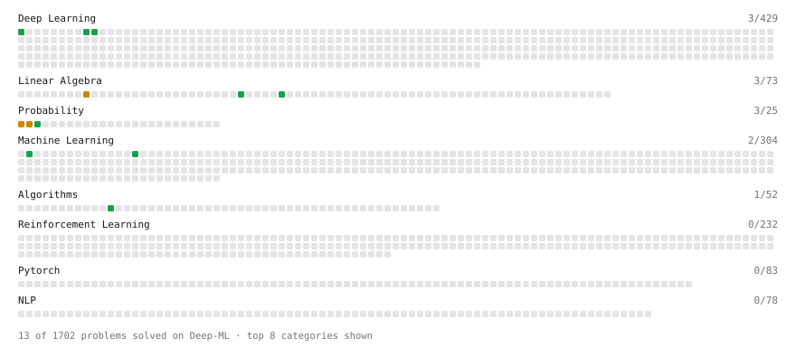

# Deep-ML

My machine learning practice from [Deep-ML](https://www.deep-ml.com). Every solution here was written by hand.

**14** solved · 13 problems · 0 labs · 1 math

[**Browse the interactive portfolio**](https://disha77777.github.io/deep-ml/) to replay this filling in over time.

## Problems

| | Difficulty | Solved | |
| --- | --- | --- | --- |
| [Calculate Accuracy Score](https://www.deep-ml.com/problems/36) | easy | 2026-10-28 | [solution](problems/0036-calculate-accuracy-score) |
| [Derivative of a Polynomial](https://www.deep-ml.com/problems/116) | easy | 2026-10-21 | [solution](problems/0116-derivative-of-a-polynomial) |
| [Dot Product Calculator](https://www.deep-ml.com/problems/83) | easy | 2026-10-27 | [solution](problems/0083-dot-product-calculator) |
| [Implement ReLU Activation Function](https://www.deep-ml.com/problems/42) | easy | 2026-10-28 | [solution](problems/0042-implement-relu-activation-function) |
| [Leaky ReLU Activation Function](https://www.deep-ml.com/problems/44) | easy | 2026-10-09 | [solution](problems/0044-leaky-relu-activation-function) |
| [Linear Regression Using Gradient Descent](https://www.deep-ml.com/problems/15) | easy | 2026-10-28 | [solution](problems/0015-linear-regression-using-gradient-descent) |
| [Poisson Distribution Probability Calculator](https://www.deep-ml.com/problems/81) | easy | 2026-10-28 | [solution](problems/0081-poisson-distribution-probability-calculator) |
| [Sigmoid Activation Function Understanding](https://www.deep-ml.com/problems/22) | easy | 2026-10-28 | [solution](problems/0022-sigmoid-activation-function-understanding) |
| [Top-K Largest Elements in a List](https://www.deep-ml.com/problems/1137) | easy | 2026-10-21 | [solution](problems/1137-top-k-largest-elements-in-a-list) |
| [Vector Element-wise Sum](https://www.deep-ml.com/problems/121) | easy | 2026-10-28 | [solution](problems/0121-vector-element-wise-sum) |
| [Binomial Distribution Probability](https://www.deep-ml.com/problems/79) | medium | 2026-10-28 | [solution](problems/0079-binomial-distribution-probability) |
| [Matrix times Matrix ](https://www.deep-ml.com/problems/9) | medium | 2026-10-27 | [solution](problems/0009-matrix-times-matrix) |
| [Normal Distribution PDF Calculator](https://www.deep-ml.com/problems/80) | medium | 2026-10-28 | [solution](problems/0080-normal-distribution-pdf-calculator) |

## Math

| | Difficulty | Solved | |
| --- | --- | --- | --- |
| [Vector Operations](https://www.deep-ml.com/math-problems/7) | easy | 2026-10-21 | [solution](math/0007-vector-operations) |

---

_This file is regenerated by Deep-ML on every push._
